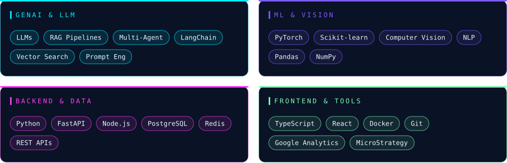
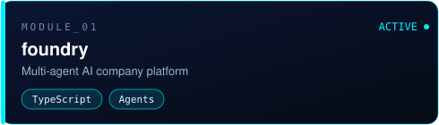
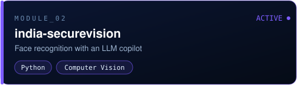
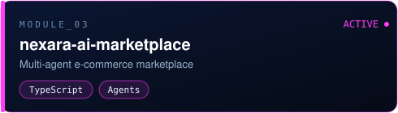
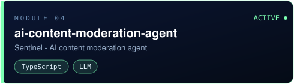
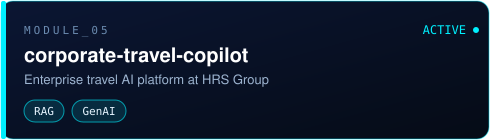
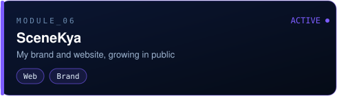

AI Engineer with 2+ years of experience shipping **Generative AI, LLM and machine learning systems** to production. At **HRS Group** I work on an AI platform for corporate travel management, designing RAG pipelines and agentic workflows that run at enterprise scale.

<table>
<tr><td width="50%"></td><td width="50%"></td></tr>
<tr><td width="50%"></td><td width="50%"></td></tr>
<tr><td width="50%"></td><td width="50%"></td></tr>
</table>

